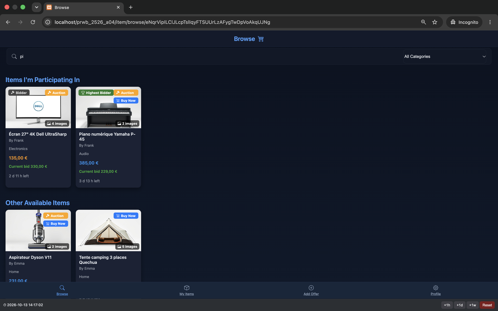
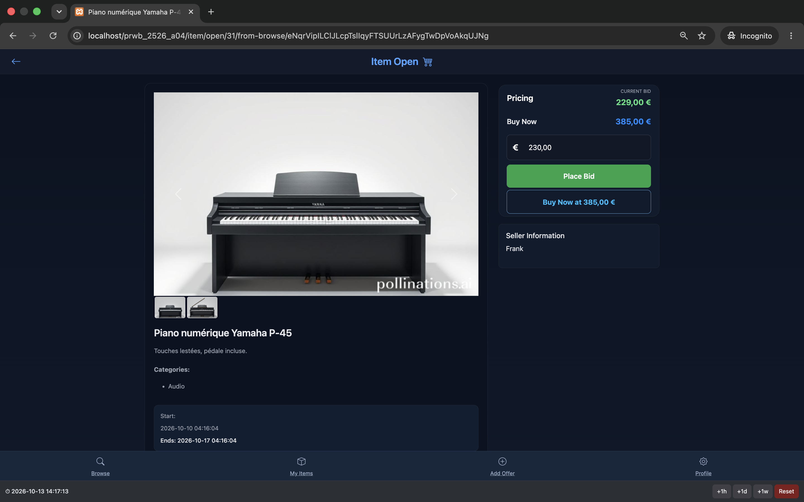
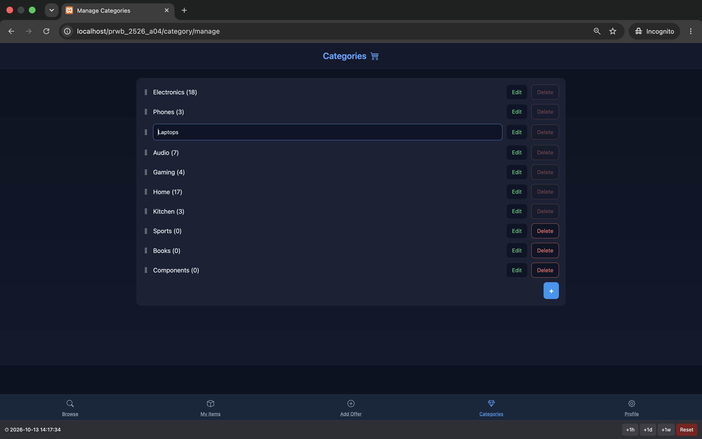

# EPayFC

An online auction and sales website, like a small eBay, made with [Bilal El Azzouzi](https://github.com/eab98) for a school project at EPFC (2025-2026).

Users can put items up for sale, either as an auction or at a fixed price with a "buy now" option. Other users can bid or buy, and everyone can follow their sales and purchases. Admins manage the item categories.

Made in PHP with an MVC structure, MySQL/MariaDB, and JavaScript (jQuery, AJAX) for the dynamic parts. The site also works with JavaScript disabled. The base MVC classes (in `framework`) were provided by the course.

## Screenshots

**Browse with live search.** The search is kept in the URL (`/item/browse/eNqr…`) and follows you to the item page.

**Item page:** image carousel, bidding and buy now.

**Category management (admin):** inline editing, drag & drop ordering. Categories that still have items can't be deleted.

## What I did

- login and sign up
- browsing the items and the item page
- the sales and purchases pages
- bidding and buying, and the actions an owner can do on their items
- full-text search, and keeping the search in the URL when you navigate (no session or cookies)
- the image carousel on the item page
- category management for admins (create, edit, delete, reorder with drag & drop)

For the third iteration, we each implemented all the features, then kept the best version of each.

## Run it

You need XAMPP (PHP and MySQL/MariaDB).

1. Put the project in XAMPP's `htdocs` folder, in a folder named `prwb_2526_a04`
   (`C:\xampp\htdocs` on Windows, `/Applications/XAMPP/xamppfiles/htdocs` on macOS).
2. In `config/prod.ini`, set `mysql_path` to the `bin` folder of your MySQL
   (e.g. `C:\xampp\mysql\bin\` on Windows, `/Applications/XAMPP/xamppfiles/bin/` on macOS).
3. Start Apache and MySQL in XAMPP, and import `database/prwb_2526_a04.sql` in phpMyAdmin to create the database.
4. Open `http://localhost/prwb_2526_a04/` and click **Reset** in the bottom bar. It loads the demo data and moves the auction dates to today.

Test accounts: `bob@example.com`, `emma@example.com`, `frank@example.com`, `grace@example.com`, and `admin@example.com` for the admin, with the password `Password1,`.

All demo users and data are fictional.
